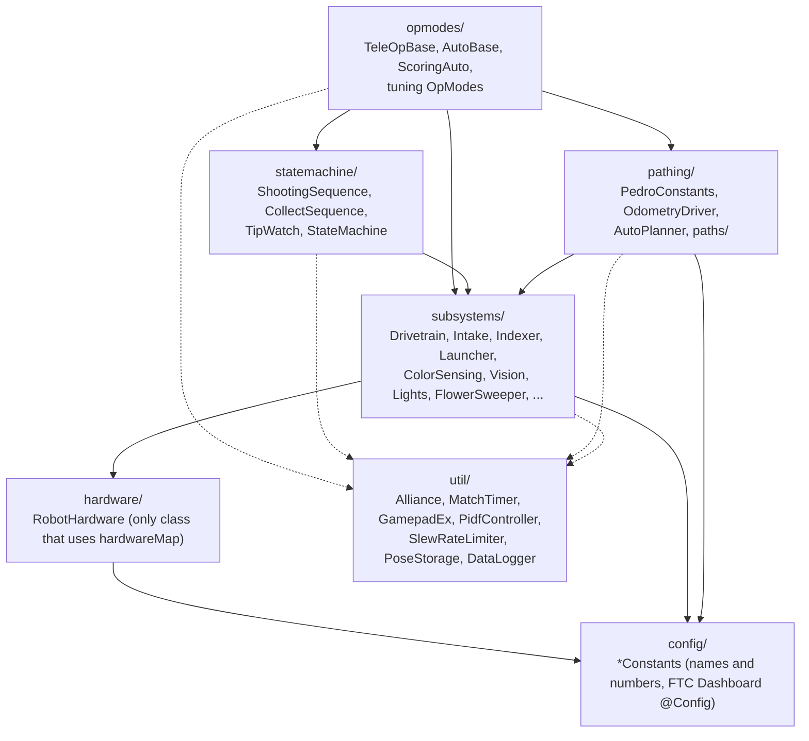
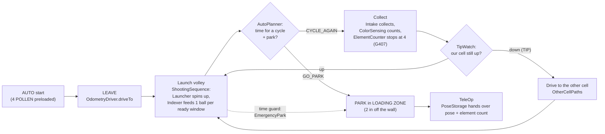

# CODE GUIDE

A tour of every Java class in IronLion30311-HiveMind, in the order a new student should read
them: **config → hardware → util → subsystems → statemachine → pathing → opmodes → tests**.
Each lower layer is used by the ones after it, so reading in this order means you always know
the classes a file depends on.

For each class you get: **what it does**, its **key public methods**, **where it came from**
(from the `// Sources:` line at the top of the file) and **how it connects** to other classes.
Paths are under `TeamCode/src/main/java/org/firstinspires/ftc/teamcode/` (tests under
`TeamCode/src/test/java/...`). Source shorthand:

| Short | Meaning |
|---|---|
| `VA` | `IronLion30311BIOBUZZInicioDeTemporada`, branch `feature/turrubiates/vision-align` @ `a7b8f4c` (the field-tested robot code) |
| `VA+` | same branch @ `d93cec3` (2026-11-24, = `master` `c98a668`): the 14 commits after `a7b8f4c`, synced on 2026-11-25 (`docs/SOURCE_SYNC.md`); headers cite them as `@ <commit>` |
| `MASTER` | same repo, branch `master` @ `37b7a16` |
| `BETA` | same repo, branch `feature/autonomos-beta` @ `206fa84` (= the `pedro-pathing-biobuzz-analysis-a65cc9` worktree) |
| `NCAM` | same repo, branch `feature/mar/duopodriveNcam` @ `2d92fba` |
| `ALP` | same repo, branch `feature/turrubiates/auto-leave-park` @ `e455142` |
| `FLOWER` | same repo, branch `feature/renata/flower-arm` @ `889102d` (its `FlowerArm` was removed in the source sync) |
| `ALIGN` | same repo, branch `feature/renata/auto-align` @ `3e733d4` |
| `TA` | same repo, branch `feature/theautonomous` @ `125df22` |
| `LUISAUTO` | same repo, branch `feature/luis/autonomospaths` @ `9cf2c66` |
| New | written for HiveMind |

Full old → new mapping: `docs/MIGRATION.md`. Layer rules: `docs/ARCHITECTURE.md`.

## Diagrams

### Layers

### A match cycle: collect → index → launch → park

In TeleOp the same mechanisms run by hand: gamepad1 LB collects (`Intake`), gamepad2 RT spins
the POLLEN `Launcher` and the `Indexer` feeds only when the flywheel is at speed, or gamepad2 A
runs the same `ShootingSequence` as AUTO.

---

## 1. `config/` — every name and number

Constants only, no logic. Classes with `@Config` can be changed live from FTC Dashboard
(`public static` fields). Read these first: every other class uses them.

| Class | What it holds | Source | Used by |
|---|---|---|---|
| `RobotConstants` | **The single source of truth for Driver Station names** (and their legacy fallbacks), robot size (18 × 18 in, `TODO: TUNE`), battery limits, indicator light colors. Sweeper servos `sweeperLeftServo` / `sweeperRightServo`. | VA `RobotHardware`, `BatteryMonitor`, `IndicatorLight`; MASTER `RobotHardware` (`pinpoint`, legacy `indexer`, green); VA+ 344254b (sweeper names) | `RobotHardware`, `PedroConstants`, `BatteryMonitor`, `Lights`, rule tests |
| `DriveConstants` | Motor directions, brake, ramps (0.3 s / 0.2 s), slow/fast speeds, stick deadzone, encoder ticks per cm, and the `OdometryDriver` gains and odometry guards. | VA `MecanumDrive`, `PedroAutoBase`, `SafeMoveAuto`; MASTER `Constants` | `Drivetrain`, `OdometryDriver`, `PedroConstants` |
| `IntakeConstants` | Direction (REVERSE, tested), power 0.75, ramp, shake, jam protection (6 A for 0.4 s → 0.4 s reverse), opponent-NECTAR stop (G408), auto-collect values. | VA `Intake`, `RobotHardware`, `PedroAutoBase`; VA+ b6913d9 | `Intake`, `CollectSequence` |
| `IndexerConstants` | Feed power, pause-when-not-ready, jam current/time and unjam steps. | VA `Indexer` (commit 9c03b6c) | `Indexer` |
| `LauncherConstants` | Ticks/rev, RPM targets (POLLEN 3000 TeleOp / 2950 AUTO, NECTAR 3600), PIDF (P 30, F 15 at 12 V), asymmetric feed window (−50 / +80 RPM, out at ±200), POLLEN idle spin (2000 RPM), shot detection, preload count. | VA `Shooter`, `PreloadRouteAuto`; MASTER `Constants`; VA+ 854de85, 19de992 | `Launcher`, `ShotDetector`, `ShootingSequence` |
| `FlowerSweeperConstants` | FLOWER sweeper: per-servo UP/DOWN positions (`TODO: TUNE`, calibrate with Tune Flower Sweeper), 0.5 s move time, goBILDA 500–2500 µs range, `LOCK_DOWN_UNTIL_NECTAR_UNLOCK` (lowering only after the G410 unlock). | VA+ 344254b `FlowerSweeper`, `RobotHardware` | `FlowerSweeper`, `RobotHardware`, `TeleOpBase`, `TuneFlowerSweeper` |
| `VisionConstants` | Limelight pipeline and filters, camera pitch, tag spacing, HIVE auto-align switch (off) and gains, HuskyLens IDs and ball-counter values. | VA `HiveVision`, `HiveGeometry`, `HiveAlignController`, `BallVision`; NCAM (tag spacing) | `HiveVision`, `HiveAligner`, `ColorSensing`, `BallCounter` |
| `ControlConstants` | Gamepad feel and TeleOp options: trigger threshold, rumbles, telemetry mode, field-centric, odometry in TeleOp, match log, auto-shoot time. | New + VA `MainTeleOp` (rumbles) | `GamepadEx`, `TeleOpBase` |
| `AutoConstants` | Near-route leg distances (cm, tested), park depth (zone's low edge), collect line along the wall, angled other-cell spot, Limelight aim limits, fitted leg time model, park margin (1.5 s) and max power, VA deadlines (11 s collect, 22 s preload volley), start delay, TIP checks, wait-TIP values, emergency park, beside-zone start. | VA `PreloadRouteAuto`, `PedroAutoBase`; VA+ 4fd2293, 1e723f2, f26f8d0; TA `TimeModel` (idea); ALP `LeaveParkAuto` | `NearRoutePoses`, `AutoPlanner`, `ScoringAuto`, `AutoBase`, `AutoSelector` |
| `FieldConstants` | BIOBUZZ field in the Pedro frame (inches, origin = red/audience corner, RED poses): territory line, HIVE box, cell centers, FLOWERS, LOADING ZONE, start poses, scoring spots, park pose. Javadoc explains G304 and the NEAR/FAR definitions. | NCAM field map; VA `PreloadRouteAuto`; BETA `ParkAuto`; `docs/AUDIT_PEDRO.md` §5.1 | `StartPosition`, `TerritoryGuard`, `EmergencyPark`, paths, rule tests |
| `MatchConstants` | Match timing (30 s AUTO, 8 s transition, 120 s TELEOP), G410 unlock (60 s, 1 s margin), endgame warnings, G407 limit (4), AUTO park reserve (4 s). | New (manual TU10) | `MatchTimer`, `ElementCounter`, `EndgameAlerts`, `AutoPlanner` |
| `TuningConstants` | Powers and steps used only by the tuning OpModes. | VA `DriveWheelTest`, `HiveStateProbe` | `opmodes/tuning/*` |

## 2. `hardware/` — the only door to the robot

### `RobotHardware`
- **What:** the only class that reads `hardwareMap`. It finds every device by its
  `RobotConstants` name, tries the legacy names if the new one is missing, sets motor
  directions/modes, and puts every hub in MANUAL bulk-caching mode. A missing device becomes a
  telemetry warning and a `null` field, never a crash.
- **Key methods:** public device fields (`frontLeftDrive`, `intakeMotor`, `pollenLauncherMotor`,
  `limelight`, …); `getDevice(type, name, legacyNames...)`; `clearBulkCache()` (call once per
  loop); `getBatteryVolts()`; `getWarnings()` / `hasWarnings()` / `addTelemetry(t)`;
  `hasDrivetrain()`, `hasIntake()`, … `hasPinpoint()`.
- **Source:** VA `RobotHardware` (getDevice with legacy names, motor setup, optional cameras);
  MASTER (pinpoint lookup); VA+ 344254b (FLOWER sweeper servos, 500–2500 µs), 023ae35 (Pinpoint device for the health read).
- **Connects:** every subsystem takes a `RobotHardware` in its constructor. The Pinpoint itself
  is owned by Pedro (`PedroConstants`), so `RobotHardware` only checks that it exists.

## 3. `util/` — small helpers with no hardware

| Class | What it does | Key methods | Source | Connects to |
|---|---|---|---|---|
| `Alliance` | RED or BLUE, and how to turn a RED pose into this alliance's pose (rotate 180° about the field center, decision D13). | `isRed()`, `getOpponent()`, `toField(Pose)`, `rotate180(Pose)`, `normalizeRadians()` | VA `vision/Alliance`, `AlliancePoses` (idea) | paths, `Vision`, `HiveCell`, OpModes |
| `MatchTimer` | Time elapsed/left in the current period, match phase, ENDGAME, and the G410 gate. Has a `Clock` interface so tests can fake time. | `start()`, `getElapsedSeconds()`, `getRemainingSeconds()`, `hasTimeFor(sec)`, `getPhase()`, `isEndgame()`, `canPlaceNectar()`, `systemClock()` | VA `autoSeconds()`; TA `MatchClock` (idea) | `AutoPlanner`, `FlowerArm`, `EndgameAlerts`, `TeleOpBase` |
| `GamepadEx` | A gamepad with "just pressed/released" detection, shaped sticks (deadzone + cubic) and rumble helpers. | `readButtons()`, `isPressed(Button)`, `wasJustPressed(Button)`, `getShapedLeftY/LeftX/RightX()`, `rumbleShort/Long()`, `rumbleBlips(n)` | VA `Shooter.handleRpmTuning`, `MainTeleOp.shapeStickInput` | `TeleOpBase`, `AutoBase`, tuning OpModes |
| `PidfController` | A PIDF controller with output limit, integral limit and static feedforward. | `setGains(...)`, `calculate(setpoint, measurement)`, `reset()` | LUISAUTO `Pid` (ideas); VA `HiveAlignController.computeAxisOutput` | `HiveAligner` |
| `SlewRateLimiter` | Makes a power change gradually (separate up/down ramps). One shared ramp instead of three copies. | `calculate(target, dtSec)`, `reset(value)`, `setRampSeconds(...)` | VA `MecanumDrive/Intake/Indexer.applyRamp` | `Drivetrain`, `Intake`, `Indexer` |
| `PoseStorage` | Hands the last AUTO pose, alliance and element count (G407) to TeleOp. | `save(pose, alliance)`, `hasPose()`, `getPose()`, `saveElementCount(n)`, `getElementCount()`, `clear()` | NCAM `PinpointOdometry.saveCurrentPose` (idea) | `AutoBase` (writes), `TeleOpBase` (reads) |
| `DataLogger` | Writes timestamped CSV files under `/sdcard/FIRST/<folder>/` on the Control Hub. | `open(folder, name, header)`, `logRow(...)`, `flush()`, `close()`, `isOpen()` | VA `LogFiles`, `ShooterLogger` | `TeleOpBase` (`match_logs`), `PoseLogger` (`auto_logs`), tuning OpModes |

## 4. `subsystems/` — one class per mechanism

Every subsystem implements **`Subsystem`**: `periodic()` (once per loop), `stop()`,
`addTelemetry(Telemetry t)`. Each takes `RobotHardware` in its constructor and has a second
constructor for tests. If its device is missing, it does nothing and says so in telemetry.
`Subsystem` itself is new (it captures the common shape of the VA subsystems).

| Class | What it does | Key methods | Source | Connects to |
|---|---|---|---|---|
| `Drivetrain` | The 4-wheel mecanum drive: robot-centric or field-centric, ramps, slow/fast, brake, battery power limit, encoder reads. Does nothing until a drive method is called (so it never fights Pedro in AUTO). | `drive(f, s, t)`, `driveRamped(...)`, `driveFieldCentric(...)`, `setSlowMode()`, `setFastMode()`, `setBrake(b)`, `setPowerLimit(l)`, `getAverageForwardCm()`, static `mix(...)` | VA `MecanumDrive`; MASTER `stop`, `getAverageForwardCm` | `SlewRateLimiter`, `BatteryMonitor`, `HiveAligner`, `TeleOpBase`, `GuardedLeaveMove` |
| `Intake` | The front intake motor. States IDLE / COLLECTING / PUSHING / EJECTING / SHAKING / UNJAMMING / FULL / OPPONENT_NECTAR. Refuses to collect when the robot holds 4 (G407), stops for opponent NECTAR (G408), reverses briefly on a current jam (VA+ b6913d9; the G408 stop wins). | `collect()`, `pushToIndexer()`, `eject()`, `idle()`, `shake()`, `setCollectGate(...)`, `setOpponentNectarDetector(...)`, `isCollecting()`, `isFull()` | VA `Intake` + `PedroAutoBase` shake | `ElementCounter` (gate), `ColorSensing` (detector), sequences |
| `Indexer` | Feeds stored balls into the flywheels, pausing while the flywheel is not at speed. Detects jams by motor current and reverses to clear them. | `feed()`, `eject()`, `idle()`, `setPaused(b)`, `isJammed()`, `isFeeding()` | VA `Indexer` | `Launcher` (ready), `ShootingSequence`, `TeleOpBase` |
| `Launcher` | The two rear flywheels (POLLEN and NECTAR) under velocity PIDF with battery-voltage-compensated feedforward and ready hysteresis (feeds only inside −50 / +80 RPM). Counts shots from RPM dips. Optional POLLEN idle spin between TeleOp volleys (`setPollenIdle`). | `spinUpPollen()`, `stopPollen()`, `reversePollen()` (and `…Nectar`), `setTargetRpm(p, n)`, `adjustPollenRpm(d)`, `isPollenReady()`, `isAtTargetRpm()`, `getPollenRpm()` | VA `Shooter`; MASTER `setTargetRpm`, `atTargetRPM`; ALIGN idle-RPM idea (off) | `ShotDetector`, `Indexer`, `ElementCounter`, `ShootingSequence` |
| `ShotDetector` | Detects one shot on one flywheel from its RPM dip and recovery; keeps per-shot stats. | `update(...)`, `getShotCount()`, `getWorstDropRpm()` | VA `ShooterLogger.ShotTracker` | `Launcher` |
| `ColorSensing` | Reads the front HuskyLens: balls by color, the closest ball, a turn command toward a ball (ball assist), NECTAR at the intake, opponent NECTAR (G408), and counts pickups. | `getClosestBall(colors...)`, `getAssistTurn(colors...)`, `isNectarAtIntake()`, `isOpponentNectarAtIntake(alliance)`, `countWhileIntaking(b)`, `getBallCount(color)`, `getTotalBalls()` | VA `BallVision`, `BallIntakeCounter`, `NectarAlertLight` | `BallCounter`, `Intake`, `ElementCounter`, `Lights`, `CollectSequence` |
| `BallCounter` | Pure counting logic: a ball counts once it leaves the camera's view near the intake. | `update(...)`, `getCount(color)`, `getTotal()`, `reset()` | VA `BallIntakeCounter` | `ColorSensing` |
| `BallColor` | POLLEN, RED_NECTAR, BLUE_NECTAR, with helpers for "is it NECTAR" and "is it the opponent's". | `isNectar()`, `isOpponentNectar(alliance)`, `nectarOf(alliance)` | VA `BallVision.BallColor` | `ColorSensing`, `Lights`, `TeleOpLogic` |
| `ElementCounter` | Keeps the number of scoring elements the robot controls (G407, max 4): collected (from `ColorSensing`) minus launched (from `Launcher`). | `canCollectMore()`, `isFull()`, `getCount()`, `setCount(n)`, `reset()` | New (G407) | `Intake` gate, `PoseStorage`, `TeleOpBase` (gamepad1 X resets) |
| `FlowerSweeper` | The FLOWER sweeper bar on two mirrored goBILDA servos: slowed-down moves between per-servo UP and DOWN positions, nothing commanded at INIT, optional lowering gate (TeleOp: G410 unlock). Optional hardware. | `down()` (bool, refused by the gate), `up()`, `toggle()`, `getState()`, `getLeftPosition()`, `setDownGate(...)` | VA+ 344254b `FlowerSweeper` | `TeleOpBase` (gamepad1 B), `TuneFlowerSweeper` |
| `Vision` | Facade over the rear Limelight: best HIVE pose, our target cell, which cell is up, TIP count, and "has this cell been gone long enough to be down". | `getAllianceTarget()`, `getUpwardCell()`, `getTipCount()`, `isCellInView(c)`, `isCellDown(c, goneSec)`, `getBestPose()` | VA `HiveVision` + `PedroAutoBase` TIP check | `HiveVision`, `TipWatch`, `HiveAligner`, OpModes |
| `Lights` | The goBILDA RGB indicator light (alliance, speed mode, launcher state) and the optional NECTAR alert light. | `setRed/Blue/Yellow/White/Green/Off()`, `blink(color)`, `showAlliance(a)`, `showLauncherState(...)`, `updateNectarAlert(color)` | VA `IndicatorLight`, `NectarAlertLight`; MASTER `setGreen` | `TeleOpLogic.pickLight`, OpModes |
| `BatteryMonitor` | Warns about a low battery (time filter + hysteresis) and caps drive power during a sudden sag to avoid a brownout. | `getVolts()`, `isLow()`, `getDrivePowerLimit()`, `getSagCount()` | VA `BatteryMonitor` | `Drivetrain`, `TeleOpBase` |

### 4.1 `subsystems/vision/` — HIVE AprilTags (Limelight 3A)

| Class | What it does | Key methods | Source |
|---|---|---|---|
| `HiveVision` | Polls the Limelight, groups tags into HIVE cells, decides which cell is upright and tracks TIPs. | `update()`, `getAllianceTarget()`, `getUpwardCell()`, `getTipCount()`, `getBestPose()`, `isCellInView(c)` | VA `HiveVision` (+ `PedroAutoBase.isCellInView`) |
| `HiveCell` | The four cells and their tag IDs (manual TU10 §9.9): `RED_BACK` 30–33, `RED_AUDIENCE` 34–37, `BLUE_AUDIENCE` 38–41, `BLUE_BACK` 42–45. | `getBackCell(alliance)`, `getAudienceCell(alliance)`, `fromTagId(id)`, `getTagIds()` | VA `HiveCell`, `vision/Alliance` (renamed for D20) |
| `HiveGeometry` | Pure math: projects tag detections onto the floor and rebuilds the 4-tag cell center. | `extractTagFloorPose(...)`, `reconstructRawCellPose(...)` | VA `HiveGeometry` |
| `HiveOrientation` | Pure angle math to decide if a cell's tag cluster is upright. | `isUpright(...)`, `circularMeanDeg(...)`, `wrapDeg(...)` | VA `HiveOrientation` |
| `HiveStateTracker` | Debounced "which of our two cells faces up", counting TIPs. | `update(...)`, `getUpwardCell()`, `getTipCount()`, `reset()` | VA `HiveStateTracker` |
| `HiveClusterPose` | Immutable floor pose of one cell relative to the camera. | (data class) | VA `HiveClusterPose` |
| `HiveAligner` | Drives to the shooting spot in front of a cell with three PD loops (forward, strafe, yaw). **Disabled by default** (`VisionConstants.HIVE_ALIGN_ENABLED = false`) until calibrated. | `isEnabled()`, `alignTo(cell)`, `evaluate(cell)`, `isAligned()`, `reset()` | VA `HiveAlignController` |

## 5. `statemachine/` — non-blocking sequences

Each sequence has `start(...)`, `periodic()` (call every loop), `isDone()`, `cancel()`. None of
them blocks, so the robot keeps reading sensors while they run.

| Class | What it does | Key methods | Source | Connects to |
|---|---|---|---|---|
| `StateMachine<S>` | Tiny helper: current state, previous state, time in state. | `setState(s)`, `restartState()`, `getState()`, `isIn(s)`, `getTimeInStateSec()` | New (pattern of VA `Indexer`) | every sequence |
| `ShootingSequence` | Shoots N POLLEN balls, one per "ready" window: spin up, wait for RPM, feed one, wait for the shot, repeat; shakes the intake if a ball is stuck; stops everything when done. | `forRobot(launcher, indexer, intake)`, `start(balls, rpm, maxSec)`, `setAimedSupplier(...)`, `getShotsFired()` | VA `PedroAutoBase.shootPollenPreload`; MASTER `shootWhenReady` (idea) | `Launcher`, `Indexer`, `Intake`; used by `AutoBase` and TeleOp auto-shoot (gamepad2 A) |
| `CollectSequence` | Drives onto the balls the HuskyLens sees with the intake on, until no ball, time up, or full (G407). Outputs drive commands; the caller applies them. | `forRobot(colorSensing, intake, counter)`, `start(maxSec, colors...)`, `getForwardCommand()`, `getTurnCommand()`, `getResult()` | VA `PedroAutoBase.collectBalls` | `ColorSensing`, `Intake`, `ElementCounter` |
| `TipWatch` | Watches one HIVE cell for a TIP (its tags gone long enough). | `forVision(vision)`, `start(cell, maxWatchSec, goneSec)`, `isCellDown()`, `isCellStillUp()`, `isUnknown()` | VA `PedroAutoBase.watchForTip`, `PreloadRouteAuto` early watch | `Vision`; used by `ScoringAuto` |

## 6. `pathing/` — where the robot goes in AUTO

| Class | What it does | Key methods | Source | Connects to |
|---|---|---|---|---|
| `PedroConstants` | Pedro Pathing 3 setup: mecanum drivetrain config (names from `RobotConstants`), Pinpoint localizer (Y pod REVERSED, fitted offsets), Foresight follower (placeholder gains, `MAX_PATH_SPEED` 0.6 until AutoTune). | `createFollower(hardwareMap)` | VA `PedroFollowerFactory` | `AutoBase`, tuning OpModes, `Tuning` |
| `OdometryDriver` | The field-tested point-to-point driver on the Pinpoint pose (through `follower.manual()`), now non-blocking. Guards: start-pose check (OK / RE-ZERO / FAULT), Pinpoint reboot recovery (a jump to (0, 0, 0) restores the last pose, up to 3 times), pose-jump lock, `lockOdometry(reason)`. | `driveTo(...)`, `driveThrough(...)`, `turnTo(name, rad)`, `hold(sec)`, `periodic()`, `isDone()`, `getResult()`, `checkStartPose(pose)`, `armPoseJumpGuard()` | VA `PedroAutoBase.driveTo/driveThrough/turnTo/holdTarget/checkOdometry` | `AutoBase`, `TestOdometryDriver` |
| `PinpointDiagnostics` | Pinpoint health from what Pedro's localizer last read: status (READY / CALIBRATING / faults), loop Hz, raw pod counts; counts fault reads and status changes. | `update()`, `record(status)`, `hasFault()`, `summary()`, `csvFields()`, `getMatchSummary()` | VA+ 023ae35 | `AutoBase` (INIT warning, fault at START locks the drive, log columns), `PoseLogger`, `TestPedroPose` |
| `AutoPlanner` | Time-budget brain: after each volley, `CYCLE_AGAIN` only if a cycle plus the park after it still fits with the 4 s reserve; otherwise `GO_PARK`. Park time budget (VA+ 1e723f2): park deadline 1.5 s before the end, volley time that leaves the park, faster park power when late, other-cell go/no-go. Fitted leg time model. | `decideNextStep(...)`, `shouldParkNow(parkSec)`, `isBeforeDeadline(sec)`, `getShootTimeLeft(...)`, `getVolleyTimeLeft(route)`, `getParkPower(route)`, `hasTimeForOtherCell(...)`, `estimateRouteSeconds(power, route)` | VA `PreloadRouteAuto` time guards; TA `MatchClock`/`TimeModel` (idea); FTC 22526 "park if the HIVE has not changed" (idea only) | `ScoringAuto`, `AutoBase` |
| `FieldDrawing` | Draws the robot, its trail and a planned path on the FTC Dashboard field view. | `draw(...)`, `drawPath(...)`, `clearTrail()` | VA `pathing/FieldDrawing` | `AutoBase`, tuning OpModes |
| `PoseLogger` | Writes the AUTO pose to `/sdcard/FIRST/auto_logs/pose_<tag>_<time>.csv`, with event rows and the Pinpoint health columns. | `start(...)`, `update(...)`, `event(...)`, `close()` | VA `pathing/PoseLogger` (pose columns only) | `AutoBase`, `DataLogger` |

### 6.1 `pathing/paths/` — the routes (RED poses; BLUE = rotated 180°)

| Class | Route | Status | Source |
|---|---|---|---|
| `RoutePaths` | Base class: holds the alliance and converts RED poses with `Alliance.toField`. | — | BETA `TickAuto` (Paths.line usage); VA `AlliancePoses` |
| `NearRoutePoses` | Every pose of the near routine, computed as "back/right of the start" in cm exactly like VA: collect line along the audience wall, angled other-cell spot (115°), PARK at the zone's low edge 2.1 in off the wall. | TESTED geometry except the VA+ changes (collect line, other spot, park depth) | VA `PreloadRouteAuto`; VA+ 4fd2293, 1e723f2 |
| `PreloadParkPaths` | LEAVE, then park through the lane west of the HIVE. | **TESTED** (last leg shortened 3.5 cm for the 2 in wall gap) | VA `PreloadRouteAuto` |
| `PreloadCollectPaths` | Collect the ball row, return to the shooting spot, park from the shooting side. | Partly tested | VA `PreloadRouteAuto` |
| `OtherCellPaths` | Around the HIVE to the other cell after a TIP, and its park. | Partly tested | VA `PreloadRouteAuto` |
| `WaitTipPaths` | Back-wall start next to the FLOWER, 10 cm LEAVE, one diagonal into the upper LOADING ZONE (no turn), with straight copies. | **UNTESTED** | VA+ f26f8d0 `FarSideWaitTipAuto` |
| `FarCyclePaths` | From the FAR start to the other-cell spot north of the HIVE, and down the west lane. | **UNTESTED** (D21) | VA waypoints; BETA `ParkAuto` start |
| `SafeParkPaths` | From the far start down the red wall into the LOADING ZONE. | Untested | BETA `ParkAuto` |
| `OuterLanePaths` | BETA "Outer Lane". | Archive / candidate, never field-tested | BETA `OuterLaneAuto` |
| `TickPaths`, `CenterLanePaths` | BETA routes that drive under the HIVE. | Archive; the under-HIVE legs are `@Deprecated` | BETA `TickAuto`, `CenterLaneAuto` |
| `ShootCollectPaths` | BETA "Shoot Turn Collect" (no park). | Archive | BETA `ShootTurnCollectAuto` |
| `TestSquarePaths` | A one-tile square for odometry tests. | Tuning | VA `OdometrySquareTestAuto` |
| `PathCatalog` | List of every path with its source, use (COMPETITION / CANDIDATE / ARCHIVE / TUNING) and risk flags (HIVE, TERRITORY, WALL, FLOWER, NO_PARK). `PathsTest` checks it. | — | New (`docs/AUDIT_PEDRO.md` §7, `BEST_OF_MATRIX` §4) |

Every route also has a `…Straight` copy (one line, same ends). Copies flagged HIVE are
`@Deprecated` and must not be used in a match.

### 6.2 `pathing/tuning/` — Pedro AutoTune and odometry tests

| Class | What it does | Source |
|---|---|---|
| `Tuning` | Registers the AutoTune procedures with `@Tuner` (web page at http://192.168.43.1:10158). | VA `pathing/tuning/Tuning` |
| `MecanumTuner`, `PinpointTuner`, `ForesightTuner`, `Tests` | Vendored from the Pedro Pathing Quickstart (BSD-3-Clause-Clear), only the package changed. Update them from upstream, do not edit. | VA copies of the Quickstart |
| `TestPedroPose` (OpMode "Test Pedro Pose") | Drive by hand and watch the odometry against the 24 in tiles, plus the Pinpoint status, Hz and pod counts; A resets to the near start. | VA `PedroPoseCheck` |
| `TestOdometrySquare` ("Test Odometry Square") | Follows a one-tile square with Pedro paths (needs AutoTune first). | VA `OdometrySquareTestAuto` |
| `TestOdometryDriver` ("Test Odometry Driver") | Drives the tested near legs with the ported `OdometryDriver`, no shooting. **Run this first** on the robot. | VA `PreloadRouteAuto` |

## 7. `opmodes/` — what the drivers select

### 7.1 `opmodes/auto/`

| Class | What it does | Source |
|---|---|---|
| `AutoBase` | Shared base of every odometry AUTO (iterative OpMode). INIT: `AutoSelector`, start-pose check, missing-device list. Loop: bulk cache, `follower.update()`, Pinpoint health and reboot recovery, G402 guard (`TerritoryGuard`), time guard (`EmergencyPark`), `OdometryDriver`, `StepSequence`, subsystems, pose log. Shared steps: drive/turn/settle, timed park, volley, TIP watch, look for a cell, wait for a stable cell, Limelight aim. Stop: saves pose and element count to `PoseStorage`. | VA `PedroAutoBase`; ALP start delay |
| `ScoringAuto` | The scoring routine: NEAR = LEAVE, 4 POLLEN at 2950 RPM, then `AutoPlanner` decides cycle or park; the cycle collects along the wall and may go to the angled other-cell spot (time-model check, Limelight aim); FAR = drive north of the HIVE first (untested). | VA `PreloadRouteAuto`; VA+ 4fd2293, 1e723f2; `BEST_OF_MATRIX` §5 |
| `AutoRedNear`, `AutoBlueNear`, `AutoRedFar`, `AutoBlueFar` | One-line subclasses that fix alliance + start. | VA `PreloadRouteAuto` annotation |
| `WaitTipAuto`, `AutoRedWaitTip`, `AutoBlueWaitTip` | Back-wall start: LEAVE, pre-spin, wait until our audience cell is up and still (partner's TIP), Limelight aim (turn limited for G402), preload volley until only the park time is left, park in the upper zone. **UNTESTED** | VA+ f26f8d0 `FarSideWaitTipAuto` |
| `AutoSafePark` | LEAVE + PARK only, no shooting, from NEAR / FAR / beside the LOADING ZONE. | VA park legs; BETA `ParkAuto`; ALP `LeaveParkAuto` |
| `AutoSafeParkEncoders` | Fallback with no Pinpoint/Pedro/cameras: 10 cm back on wheel encoders (LEAVE only). | ALP `LeaveParkAuto` |
| `AutoSelector` | The INIT menu logic (alliance, start, delay). Pure, tested. | VA INIT buttons; ALP delay |
| `StartPosition` | NEAR, FAR, LOADING_ZONE (beside the zone, G304.E), BACK_WALL (wait-TIP start) with labels and RED poses. | VA, BETA, ALP; VA+ f26f8d0 |
| `AutoStep` | One non-blocking step (a leg, a turn, a volley, a TIP watch, a wait or an instant decision). | VA `PedroAutoBase` helpers |
| `StepSequence` | Runs `AutoStep`s in order, supports inserted decisions and "abort and park". | VA `runRoutine`; TA `RouteRunner` (idea) |
| `EmergencyPark` | Plans a park with no in-place turn from any pose when time runs out (west lane, keeps clear of the HIVE; the PARK leg squares the heading to the walls). | VA park legs |
| `GuardedLeaveMove` | Short straight move on wheel encoders with a hard timeout. | ALP `GuardedStraightDrive` |
| `TerritoryGuard` | G402 check with the heading-aware robot footprint; stops the drive for the rest of AUTO if crossed. | New |

### 7.2 `opmodes/teleop/`

| Class | What it does | Source |
|---|---|---|
| `TeleOpBase` | The competition TeleOp: gamepads → subsystems, auto-shoot, POLLEN idle spin, FLOWER sweeper, G407/G408/G410 wiring, endgame alerts, competition/debug telemetry, match CSV log, AUTO pose hand-off. | VA `MainTeleOp`; NCAM saved-pose idea |
| `TeleOpRed`, `TeleOpBlue` | Fix the alliance (no INIT button to forget). | VA `MainTeleOp` |
| `TeleOpLogic` | Pure TeleOp decisions (light choice, volley size, element count at start, ball-assist colors and when the assist may turn (`shouldBallAssist`: driving forward, no launcher), clock text). | VA `MainTeleOp` |
| `EndgameAlerts` | Fires the 65 s and 60 s warnings once each. | New |

### 7.3 `opmodes/tuning/`

| Class (DS name) | What it does | Source |
|---|---|---|
| `TestDriveWheels` ("Test Drive Wheels") | One wheel per bumper/trigger, A = all: checks ports, directions, encoder signs. | VA `DriveWheelTest` |
| `TestIndexerIntake` ("Test Indexer Intake") | Runs intake/indexer by hand and shows current, to tune jam detection. CSV `current_logs`. | New (VA `Indexer` values) |
| `TuneColorSensor` ("Tune Color Sensor") | Shows HuskyLens blocks and their classification. | VA `MainTeleOp` ball telemetry |
| `TuneHiveVision` ("Tune Hive Vision") | HIVE orientation signals per cell and a labeled per-tag CSV (`hive_logs`). | VA `HiveStateProbe` |
| `TuneLauncherPidf` ("Tune Launcher PIDF") | Holds an RPM, tunes gains live, graphs `Graph/TargetRpm` vs `Graph/Rpm` on FTC Dashboard. CSV `launcher_logs`. | VA `MainTeleOp` graphs, `ShooterLogger` columns |
| `TuneFlowerSweeper` ("Tune Flower Sweeper") | Moves the sweeper servos (left, right or both mirrored) in coarse/fine steps, stores UP/DOWN, prints the values to copy. | VA+ 344254b `SweeperServoCalibration` |

## 8. Tests (`TeamCode/src/test/java/...`)

Run with `./gradlew testDebugUnitTest`. They run on the computer, not the robot, and use
`testutil/FakeClock` so time-based logic needs no waiting.

| Test class | What it proves |
|---|---|
| `config/FieldConstantsTest` | RED poses respect G402; park is partly in the LOADING ZONE and 2 in off the wall; zone matches the manual. |
| `opmodes/auto/AutoSafetyTest` | `TerritoryGuard` (including turned corners), `EmergencyPark` never touches the HIVE, encoder LEAVE, competition parks give LEAVE + PARK. |
| `opmodes/auto/AutoSelectorTest` | INIT menu: alliance, start position, delay limits and steps. |
| `opmodes/auto/StartPositionRulesTest` | Every start pose obeys G304 (both alliances) and the robot fits 18 × 18 in. |
| `opmodes/auto/StepSequenceTest` | Step order, inserted decisions, abort-to-park. |
| `opmodes/teleop/TeleOpLogicTest` | Lights, volley size, ball-assist colors (never opponent NECTAR), element count from AUTO, endgame alerts. |
| `pathing/AutoPlannerTest`, `pathing/CycleBudgetTest` | Deadlines, estimates, and the "cycle again or park" decision. |
| `pathing/OdometryDriverTest` | The driver against a simulated robot: step API, guards, sign conventions. |
| `pathing/PinpointDiagnosticsTest` | Fault statuses, status-change and fault-read counters, missing Pinpoint. |
| `pathing/PathsTest` | Every catalog path vs. the rules: HIVE flags, territory line, field bounds, parks in the zone, straight copies, BLUE = RED rotated 180°. |
| `statemachine/ShootingSequenceTest`, `CollectSequenceTest`, `StateMachineAndTipWatchTest` | The non-blocking sequences and `StateMachine` timers. |
| `subsystems/DrivetrainTest` | Mecanum mixing and field-centric rotation. |
| `subsystems/IndexerTest` | Jam/unjam state machine. |
| `subsystems/IntakeTest` | Jam protection: high current while collecting reverses then resumes; short peaks and the start-up spike are ignored; the G408 stop wins over an unjam. |
| `subsystems/LauncherLogicTest` | Ready hysteresis and the asymmetric feed window, POLLEN idle (never ready, off at stop), voltage-compensated kF, shot detection. |
| `subsystems/ColorSensingTest`, `BallCounterTest` | G408 stop, own NECTAR does not stop the intake, ball counting. |
| `subsystems/ElementCounterTest` | G407: the fifth element is refused. |
| `subsystems/FlowerSweeperTest` | Slowed, mirrored travel; nothing moves before the first command; lowering waits for the gate, raising never does. |
| `subsystems/BatteryMonitorTest` | Low-battery filter, hysteresis, sag limit. |
| `subsystems/vision/HiveCellTest` | Tag ownership and `BallColor` alliance helpers. |
| `subsystems/vision/HiveGeometryTest`, `HiveOrientationTest`, `HiveStateTrackerTest` | Ported VA vision tests (VA `src/test` @ a7b8f4c). |
| `util/*Test` (`AllianceTest`, `MatchTimerTest`, `GamepadExTest`, `PidfControllerTest`, `SlewRateLimiterTest`, `ControllerEdgeCasesTest`, `PoseStorageTest`, `DataLoggerTest`) | The helpers, including G410 unlock edges and match timing from the manual. |
| `testutil/FakeClock`, `testutil/RuleGeometry` | Shared helpers: a hand-moved clock; robot footprint checks for G304, LEAVE and PARK. |
